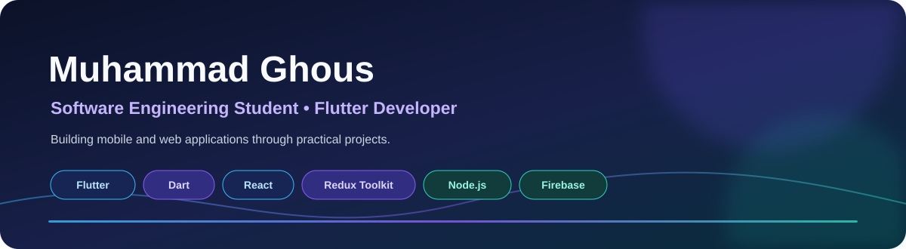
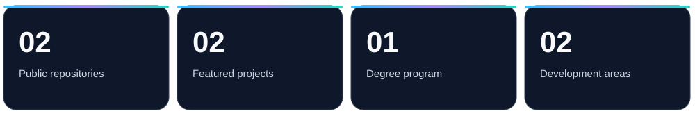

### Software Engineering Student · Flutter Developer

Building mobile and web applications while continuing to grow as a developer.

## 

I am Muhammad Ghous, a **BS Software Engineering student** at **COMSATS University Islamabad, Sahiwal Campus**. I work on mobile and web application projects and continue developing my skills through practical implementation.

## 

### [Flutter Chat Application](https://github.com/GhousMaqbool/Flutter_chatapp)

A Flutter chat application repository using Firebase services.

- **Mobile:** Flutter, Dart
- **Backend services:** Firebase Authentication, Cloud Firestore

### [Myntra React Clone](https://github.com/GhousMaqbool/React-Myntra-project)

A full-stack e-commerce clone featuring product listings, image sliders, cart management, and dynamic price calculations.

- **Frontend:** React, Redux Toolkit, React Router, Bootstrap, CSS
- **Backend:** Node.js, Express
- **Database:** MongoDB, Mongoose

## 

**Frontend**

**Backend**

**Cloud & Services**

**Databases**

**Tools**

## 

| Area | Demonstrated through |
|---|---|
| Mobile application development | Flutter chat application |
| Frontend development | React and Redux Toolkit e-commerce interface |
| Backend development | Node.js and Express project backend |
| Data storage | Cloud Firestore and MongoDB |

## 

**BS Software Engineering**  
COMSATS University Islamabad, Sahiwal Campus

## 

## 

- GitHub: [@GhousMaqbool](https://github.com/GhousMaqbool)

*Thanks for visiting my profile.*

